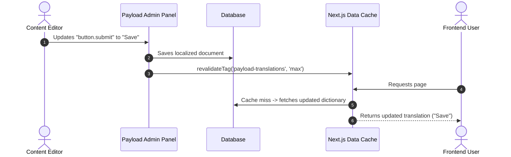

# payload-plugin-dictionary

[](https://www.npmjs.com/package/payload-plugin-dictionary)
[](https://opensource.org/licenses/MIT)
[](https://payloadcms.com)
[](https://nextjs.org)
[](https://www.typescriptlang.org)

A high-performance **Payload CMS v3** plugin that migrates static front-end translation keys (`en.json`, `ar.json`, `fr.json`) into your database. Empower content editors to manage UI microcopy—such as buttons, navigation labels, headers, and error messages—directly within the Payload Admin panel, with instant on-demand cache revalidation and zero required third-party frontend dependencies.

---

## 🌟 Why This Plugin?

| Traditional Static i18n (`en.json`)                | With `payload-plugin-dictionary`                        |
| -------------------------------------------------- | ------------------------------------------------------- |
| Hardcoded in Git repository                        | Managed in Payload Admin Panel                          |
| Copy changes require Pull Requests & redeployments | Instant updates with zero downtime                      |
| Content editors cannot modify microcopy            | Content editors have full localized control             |
| Often requires bulky client bundles                | Next.js Server Components with automatic cache eviction |

---

## ✨ Features

- 🗄️ **Database-Backed Translations**: Moves static translation keys into a dedicated `translations` collection with native localization support.
- ⚡ **Next.js Data Cache Integration**: Wrapped with `unstable_cache` and tagged with `'payload-translations'`, ensuring database queries are cached and served in milliseconds.
- 🔄 **Instant On-Demand Revalidation**: Automatically invalidates cache tags when translations are created, updated, or deleted via Payload collection hooks.
- ⚛️ **Zero Third-Party Dependency Mode**: Full standalone support with callable `t('key')` functions for React Server Components and Client Components (`<DictionaryProvider>` + `useTranslations()`).
- 🔌 **Seamless `next-intl` & `i18next` Compatibility**: Easily acts as the dynamic message provider for existing i18n libraries.
- 🌐 **Built-in REST Endpoint**: Direct HTTP access via `GET /api/dictionary/:namespace?locale=:locale` with HTTP caching headers.
- 🛡️ **Type Safety & CLI Generator**: Run `npx payload-dictionary generate` to generate TypeScript types directly from database keys for full IDE autocompletion.
- 🔒 **Data Integrity**: Enforces dot-separated key notation (e.g., `auth.login_button`) and ensures composite uniqueness across `(namespace, key)` pairs.

---

## 📦 Installation

```bash
# Using pnpm
pnpm add payload-plugin-dictionary

# Using npm
npm install payload-plugin-dictionary

# Using yarn
yarn add payload-plugin-dictionary
```

### Peer Dependencies

- `payload`: `^3.90.0`
- `next`: `^15.0.0 || ^16.0.0`
- `react`: `^19.0.0` _(optional; only needed if using client `<DictionaryProvider>` or `useTranslations`)_

---

## ⚙️ Configuration

Add `dictionaryPlugin` to your `payload.config.ts`:

```typescript
import { buildConfig } from 'payload'
import { dictionaryPlugin } from 'payload-plugin-dictionary'

export default buildConfig({
  localization: {
    locales: ['en', 'ar', 'fr'],
    defaultLocale: 'en',
    fallback: true,
  },
  plugins: [
    dictionaryPlugin({
      namespaces: ['common', 'auth', 'marketing'],
      defaultNamespace: 'common',
    }),
  ],
  // ... your remaining Payload configuration
})
```

### Plugin Options

| Option             | Type       | Required | Default         | Description                                                         |
| ------------------ | ---------- | -------- | --------------- | ------------------------------------------------------------------- |
| `namespaces`       | `string[]` | **Yes**  | —               | Array of permitted namespaces (e.g. `['common', 'auth']`).          |
| `defaultNamespace` | `string`   | No       | `namespaces[0]` | Default namespace selected when creating new translation documents. |

---

## 🚀 Usage Guide

You can use this plugin in **two ways**:

1. **Standalone (Zero Dependencies)**: Using our built-in `getTranslations`, `<DictionaryProvider>`, and `useTranslations()` hook.
2. **With an i18n Library (`next-intl`)**: Supplying the dictionary messages directly to `next-intl`.

---

### Option 1: Standalone (Zero Dependencies)

#### 1. React Server Components (RSC)

In any React Server Component, call `getTranslations()`:

```tsx
// app/[locale]/page.tsx
import { getTranslations } from 'payload-plugin-dictionary/cache'

export default async function HomePage({ params }: { params: Promise<{ locale: string }> }) {
  const { locale } = await params
  const t = await getTranslations('common', locale)

  return (
    <main>
      {/* 1. Basic lookup */}
      <h1>{t('home.title')}</h1>

      {/* 2. Variable interpolation */}
      <p>{t('welcome.user', { name: 'Sarah' })}</p>

      {/* 3. Safe fallback if key is missing */}
      <button>{t('button.submit', 'Submit')}</button>
    </main>
  )
}
```

#### 2. React Client Components

To use translations inside `'use client'` components, fetch the dictionary in your Server Layout and wrap the children with `<DictionaryProvider>`:

```tsx
// app/[locale]/layout.tsx (Server Component)
import { getDictionary } from 'payload-plugin-dictionary/cache'
import { DictionaryProvider } from 'payload-plugin-dictionary/client'

export default async function LocaleLayout({
  children,
  params,
}: {
  children: React.ReactNode
  params: Promise<{ locale: string }>
}) {
  const { locale } = await params

  // Fetch raw dictionary for the client provider
  const dictionary = await getDictionary('common', locale)

  return (
    <html lang={locale}>
      <body>
        <DictionaryProvider dictionary={dictionary}>{children}</DictionaryProvider>
      </body>
    </html>
  )
}
```

Now call `useTranslations()` in any Client Component anywhere in the tree:

```tsx
// components/CounterButton.tsx
'use client'

import { useTranslations } from 'payload-plugin-dictionary/client'
import { useState } from 'react'

export function CounterButton() {
  const t = useTranslations()
  const [count, setCount] = useState(0)

  return (
    <div>
      <button onClick={() => setCount((c) => c + 1)}>
        {t('button.click_me')} ({count})
      </button>

      {/* Interpolation in client components */}
      <p>{t('items.count', { count })}</p>

      {/* Fallback support */}
      <button onClick={() => setCount(0)}>{t('button.reset', 'Reset Counter')}</button>
    </div>
  )
}
```

#### 3. Translator Function API

The `t` function returned by `getTranslations()` and `useTranslations()` provides:

| Signature                  | Description                                                | Example                                      |
| -------------------------- | ---------------------------------------------------------- | -------------------------------------------- |
| `t(key)`                   | Looks up key; returns key string if missing                | `t('button.submit')`                         |
| `t(key, params)`           | Replaces `{var}` placeholders with values                  | `t('greeting', { name: 'Alex' })`            |
| `t(key, fallback)`         | Returns fallback text if key is missing                    | `t('button.save', 'Save Changes')`           |
| `t(key, params, fallback)` | Replaces placeholders with fallback text if key is missing | `t('hello', { name: 'Alex' }, 'Hello Alex')` |
| `t.has(key)`               | Returns `true` if key exists in dictionary                 | `if (t.has('banner.alert')) ...`             |
| `t.raw(key)`               | Returns raw uninterpolated string or `undefined`           | `t.raw('welcome')`                           |
| `t.dictionary`             | Direct reference to `Record<string, string>` map           | `Object.keys(t.dictionary)`                  |

---

### Option 2: Using with `next-intl`

If your project already uses `next-intl`, `payload-plugin-dictionary` integrates seamlessly as the message source.

Configure `i18n/request.ts`:

```typescript
// i18n/request.ts
import { getRequestConfig } from 'next-intl/server'
import { getDictionary } from 'payload-plugin-dictionary/cache'

export default getRequestConfig(async ({ requestLocale }) => {
  const locale = (await requestLocale) || 'en'

  // Fetch from Payload database with automatic Next.js caching
  const messages = await getDictionary('common', locale)

  return {
    locale,
    messages,
  }
})
```

Consume in your components using standard `next-intl` APIs:

```tsx
import { useTranslations } from 'next-intl'

export function Header() {
  const t = useTranslations()
  return <h1>{t('nav.home')}</h1>
}
```

---

## 🌐 Built-in REST API

The plugin automatically registers an HTTP REST endpoint on your Payload server:

```http
GET /api/dictionary/:namespace?locale=:locale
```

### Example Request

```http
GET /api/dictionary/common?locale=ar
```

### Example Response

```json
{
  "button.submit": "إرسال",
  "button.cancel": "إلغاء",
  "nav.home": "الرئيسية",
  "footer.copyright": "جميع الحقوق محفوظة © 2026"
}
```

### Response Headers

- `Content-Type: application/json`
- `Cache-Control: public, s-maxage=3600, stale-while-revalidate=86400`

---

## 🛠️ TypeScript CLI Type Generator

Generate strongly-typed TypeScript definitions from your database keys for IDE autocompletion:

```bash
# Run the generator
npx payload-dictionary generate
```

### Generated Output (`dictionary.d.ts`)

```typescript
/**
 * Auto-generated by payload-dictionary. Do not edit manually.
 */
export type CommonTranslationKeys = 'button.submit' | 'button.cancel' | 'home.title'

export type AuthTranslationKeys = 'login.button' | 'error.invalid_credentials'

export type AllTranslationKeys = `common:${CommonTranslationKeys}` | `auth:${AuthTranslationKeys}`
```

---

## 🔄 Cache Architecture & Invalidation



- Invalidation occurs automatically on `afterChange` and `afterDelete` hooks.
- Compatible with Next.js 15 and Next.js 16 cache models.
- Gracefully handles execution outside Next.js request contexts (e.g., test suites, CLI tools).

---

## 📁 Package Entrypoints

| Subpath                            | Target                       | Use Case                                                                |
| ---------------------------------- | ---------------------------- | ----------------------------------------------------------------------- |
| `payload-plugin-dictionary`        | `src/index.ts`               | Plugin initialization & root types                                      |
| `payload-plugin-dictionary/cache`  | `src/cache/getDictionary.ts` | `getTranslations()`, `getDictionary()` (Server-only)                    |
| `payload-plugin-dictionary/client` | `src/client/index.tsx`       | `<DictionaryProvider>`, `useTranslations()`, `useDictionary()` (Client) |

---

## 🧪 Testing

The repository includes complete integration and end-to-end tests:

```bash
# Run unit & integration tests (Vitest)
pnpm test:int

# Run admin panel E2E tests (Playwright)
pnpm test:e2e

# Run linter
pnpm lint

# Build production bundle
pnpm build
```

---

## 📄 License

MIT © [Mahmoud Hassan](https://github.com/Mhmod-Hsn)
